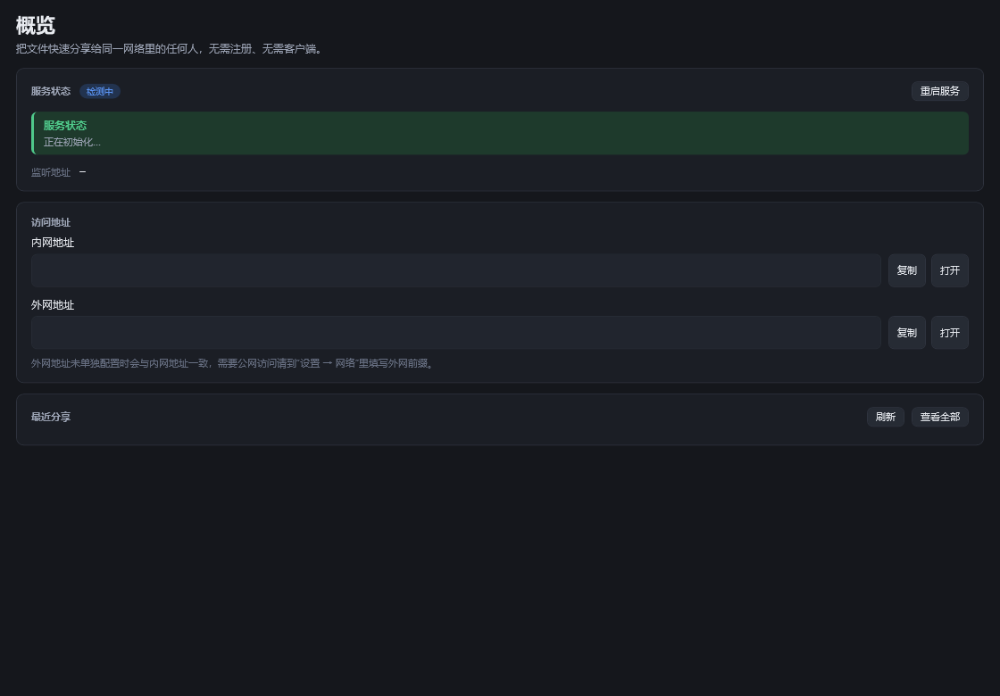
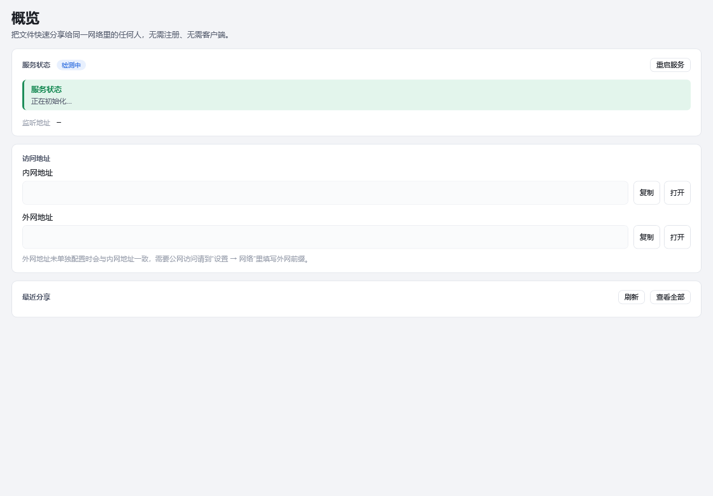
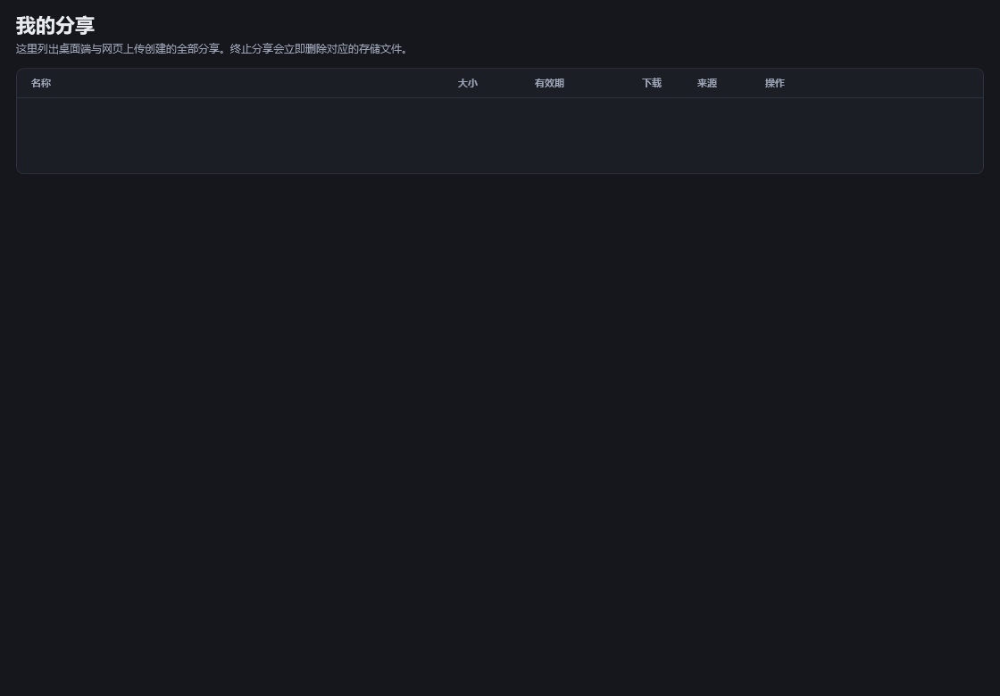
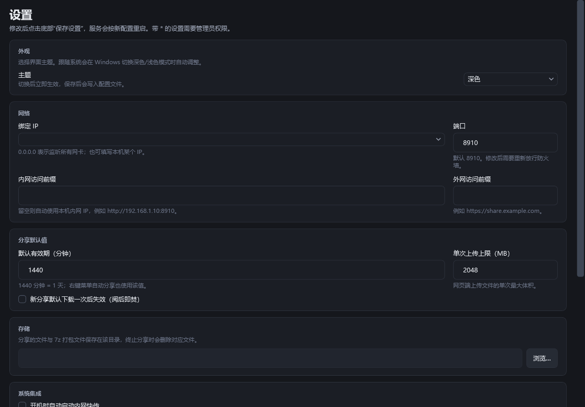
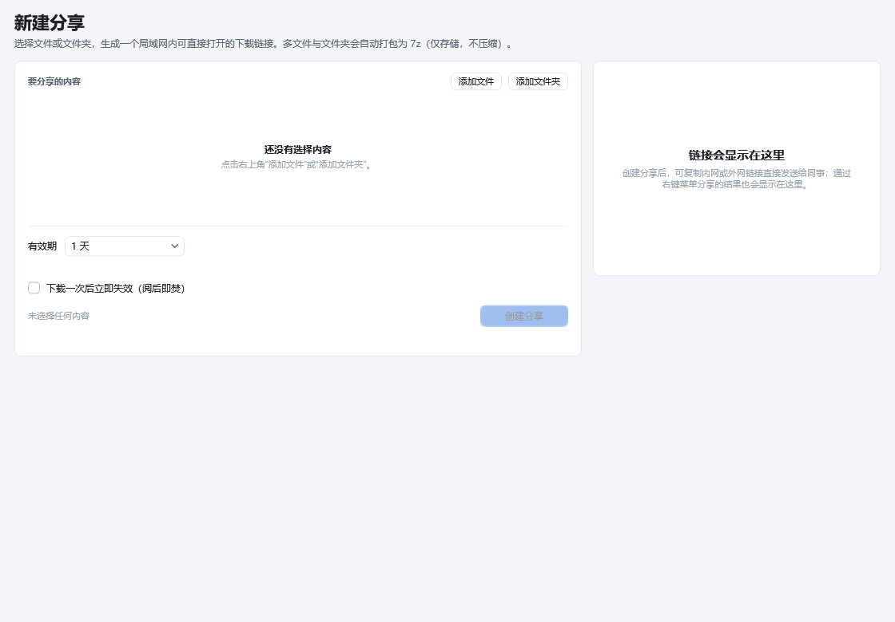

# 内网快传 LanShare

Windows 原生的局域网文件快传工具：桌面端建分享，任何设备用浏览器上传、下载、终止分享。

- **技术栈**：WPF（.NET 8）+ 内嵌 Kestrel Web 服务
- **桌面端**：自绘界面，浅色 / 深色 / 跟随系统三档主题
- **网页端**：Bootstrap 5，手机、平板、其他电脑打开即用，无需安装任何东西
- **体积**：自包含发布，安装包内含 .NET 运行时，目标机无需预装
- **许可**：GPL-3.0

[](https://github.com/cfengli007/LanShare/releases)
[](LICENSE)

## 截图

桌面端使用自绘标题栏 + 顶部菜单 + 图标栏 + 状态条 + 底部按钮栏的五行结构，浅色 / 深色双主题。
所有截图均为**离屏渲染**（`RenderTargetBitmap`），不含桌面干扰。

| 概览（深色） | 概览（浅色） |
|---|---|
|  |  |

| 我的分享（深色） | 设置（深色） |
|---|---|
|  |  |

新建分享（浅色）：



网页端（手机宽度 430 px，Bootstrap）：


> 截图重出方法见 [docs/screenshots/README.md](docs/screenshots/README.md)。
> 注意：**不要用 `PrintWindow` 截 WPF 窗口**——它返回缓存表面，可能截到旧画面（实测三次截图字节完全相同）。
> 可靠做法是离屏 `RenderTargetBitmap`，或 `Graphics.CopyFromScreen` 抓窗口矩形。

## 功能

| 功能 | 说明 |
|---|---|
| 原生 Windows 桌面端 | WPF 自绘界面，不含任何第三方 UI 控件库；五区骨架（标题栏 / 菜单栏 / 内容区 / 状态条 / 按钮栏） |
| 内嵌 Web 服务 | Kestrel 监听 `0.0.0.0:8910`（可改），不需要另装 IIS 或 Nginx 就能在局域网访问 |
| 网页上传与续传 | 手机、平板、其他电脑打开网页即可拖拽上传；按 8 MiB 分片，断网或关页面后 24 小时内可继续 |
| 下载断点续传 | `/d/{id}` 支持 HTTP Range + ETag，浏览器、IDM、aria2 都能续传 |
| 我的分享 | 网页端凭 Cookie 识别身份，可复制链接、终止分享；桌面端看得到全部来源的分享 |
| 右键快捷分享 | 资源管理器右键单个/多个文件或文件夹 →「用内网快传分享」，Windows 11 直接显示在一级菜单 |
| 单文件直链 / 多文件打包 | 一个文件按原文件下载；多个文件或文件夹用内置 7-Zip 打包（仅存储不压缩） |
| 链接定时失效 | 10 分钟 / 1 小时 / 6 小时 / 1 天 / 7 天 / 自定义分钟（1 – 43200，最长 30 天） |
| 下载即焚 | 可选，首次**完整**下载完成后立即销毁分享和文件 |
| 手动终止 | 桌面端或网页端随时撤销分享并删除 LanShare 管理的文件 |
| 内网 / 外网双前缀 | 内网前缀（如 `http://192.168.1.10:8910`）与外网前缀（如 `https://share.example.com`）可分别设置 |
| 网络工具 | 识别本机 IPv4、绑定网卡、修改本机 IP（DHCP / 静态）、一键放行 Windows 防火墙 |
| 托盘常驻 | 关闭主窗口最小化到托盘；托盘菜单可新建分享、打开网页、复制地址、退出 |
| 单实例 | 再次右键分享不会开多个进程，通过命名管道把路径转给已运行实例，600 ms 去抖合并多选 |
| 双主题 | 浅色 / 深色 / 跟随系统，含 DWM 原生深色框架与圆角（见 [docs/UI-DESIGN.md](docs/UI-DESIGN.md)） |
| 应用自更新 | 从 GitHub Releases 检查、下载并启动安装包，不走 REST API（见下文「更新机制」） |

## 安装

### 安装版（推荐）

从 [Releases](https://github.com/cfengli007/LanShare/releases) 下载 `LanShare-Setup-<版本>-win-x64.exe` 运行。

安装向导为标准 Inno Setup 界面（简体中文）：

```
欢迎 → 选择安装目录 → 附加任务（右键菜单 / 桌面快捷方式）→ 安装 → 完成
```

1. 双击安装包，在 UAC 提示中点「是」（写入 Program Files 需要一次管理员权限）。
2. 选择安装位置：有 D: 盘时默认 `D:\Program Files (x86)\LanShare`，否则 `C:\Program Files\LanShare`。
   保持「添加资源管理器右键菜单」勾选；需要桌面图标再勾「创建桌面快捷方式」。
3. 安装完成后勾选「启动内网快传」，Web 服务会自动运行，「概览」页显示内网访问地址。
4. 在「设置」里确认绑定 IP、端口和存储目录；需要时点「放行防火墙」。

**前置条件**：Windows 10 19041+ / Windows 11，x64。安装包是**自包含**发布，目标机不需要装 .NET 8。

**卸载**：Windows「设置 → 应用 → 内网快传 LanShare → 卸载」，或开始菜单里的「卸载 内网快传 LanShare」。
设置、分享记录和上传/归档文件默认保留在 `%LOCALAPPDATA%\LanShare`。

### 免安装版

从 [Releases](https://github.com/cfengli007/LanShare/releases) 下载 `LanShare-<版本>-win-x64.zip`。

1. 解压到任意目录（例如 `D:\Tools\LanShare`）。
2. 双击 `LanShare.exe`。
3. 首次启动会创建 `%LOCALAPPDATA%\LanShare`，自动启动 Web 服务并在「概览」页显示内网地址。
4. 在「设置」里确认绑定 IP、端口和存储目录；需要时点「放行防火墙」。
5. 在「新建分享」选择文件 / 文件夹，或直接在资源管理器右键分享。

局域网其他设备访问「概览」里显示的内网地址即可（例如 `http://192.168.1.10:8910`）。

### Windows 11 一级右键菜单

菜单是纯**用户级**注册表实现的——三个 `shell\LanShare` 动词键（文件 / 文件夹 / 文件夹空白处）都指向同一个
`ExplorerCommandHandler`，该 CLSID 再在 `HKCU\Software\Classes\CLSID` 里指向随程序分发的 `LanShare.Shell.dll`
（实现 `IExplorerCommand`）。所以「用内网快传分享」**直接出现在 Windows 11 的一级右键菜单里**，不用再点「显示更多选项」。

- 不需要 MSIX 包、不需要证书、不需要写 HKLM；卸载时随 `uninsdeletekey` 一并清掉。
- 支持多选：选中多个文件 / 文件夹一次分享（`MultiSelectModel=Player`）。
- 也可以在「设置 → 资源管理器右键菜单」里随时重装 / 卸载。装 / 卸之后如果资源管理器没刷新，重启 explorer 或注销重登即可。

### 安装包做了什么

- 复制程序到 `D:\Program Files (x86)\LanShare`（无 D: 盘时回退到 `C:\Program Files\LanShare`，向导里可改）。
- 写入当前用户的资源管理器右键菜单（文件、文件夹、文件夹空白处）。
- 创建开始菜单快捷方式；桌面快捷方式可选。
- 注册标准卸载项；卸载时先 `taskkill` 结束进程，再清理右键菜单。不删除 `%LOCALAPPDATA%\LanShare` 中的分享数据。

## 使用说明

### 创建分享

- **桌面端**：新建分享 → 选择文件（可多选）或文件夹 → 选择有效期 / 下载即焚 → 生成。
- **右键菜单**：选中文件 / 文件夹 → 右键 →「用内网快传分享」。多选时用 `MultiSelectModel=Player` 一次传入全部路径。
- **网页端**：打开首页，拖拽或选择文件，设置有效期，点击上传；上传完成即生成链接。

单文件分享直接**引用原文件**，不复制、不删除；多文件或文件夹会生成 `.7z` 归档
（仅存储不压缩，Windows 11 资源管理器、7-Zip、WinRAR 均可解压）。归档生成在存储目录中，
撤销 / 过期时只删除归档，不碰原文件。

### 下载与销毁

- 分享页 `/s/{id}` 展示文件列表、大小、剩余时间。
- 下载地址 `/d/{id}`，支持 Range 断点续传和 ETag 校验；中文文件名使用 RFC 5987 编码。
- 上传按 8 MiB 分片写入临时会话，未完成的上传在 24 小时内可恢复；网页刷新后会提示「发现未完成的上传」。
- 下载即焚的分享在**首次完整下载响应完成**后删除；之后访问返回 410。
  注意：客户端用 Range 分段下载时分段本身不会触发销毁，需要一次覆盖完整文件的请求（普通浏览器点下载就是整文件）。
- 在网页「我的分享」或桌面「我的分享」中点击「终止」，立即删除分享及其管理的数据。

### 网页身份

网页首次访问时服务端写入 `lanshare_uid` Cookie（HttpOnly、SameSite=Lax、有效期一年），上传的分享归该 Cookie 所有。
桌面端创建的分享 owner 为 `desktop`，网页不可见；桌面端可查看全部。

清除浏览器 Cookie 后会变成新身份，无法再管理旧分享；请用同一个浏览器继续管理。

## 传输速度参考（1000M 内网）

下面是**单流、大文件（≥ 1 GB）、SSD、MTU 1500** 的工程估算，不是本机实测值；实际会被网卡、交换机、路由器 NAT/防火墙、Wi-Fi、磁盘和浏览器限制。

先记住换算：**1000 Mbps = 125 MB/s**。TCP/IP 头、ACK、重传会吃掉 5%–8%，所以千兆网卡的实用上限约 **110–118 MB/s**。

如果流量要绕到旁路由做 SSL 卸载，同一份数据在 1G 口上进出各一次，**等效可用带宽约 500 Mbps（62.5 MB/s）**。这是主要瓶颈，TLS 反而不是。

| 场景 | 链路/瓶颈 | 大文件稳定速度（预估） |
| --- | --- | --- |
| HTTP 直连（同一交换机/同网段，不绕旁路由） | 1 Gbps 全双工 | **105–118 MB/s**（约 840–940 Mbps） |
| HTTP 经旁路由三层转发（不做 TLS） | 1 Gbps，路由 NAT/转发 | **85–110 MB/s**（约 680–880 Mbps）；路由器弱时可能 50–80 MB/s |
| HTTPS 经旁路由 SSL 卸载 | 1G 口 hairpin，等效 500 Mbps | **52–58 MB/s**（约 420–470 Mbps） |
| 上传（以上任一场景，客户端→本机） | 同上，另加磁盘写入 | 与下载基本相同；SSD 不会成为瓶颈，机械盘约 100–180 MB/s |
| 小文件 / 大量小文件 | 延迟与请求数主导 | 远低于上表；单文件 <1 MB 时更多取决于 RTT 和浏览器并发 |

说明：

- HTTPS 卸载场景的 TLS 握手、加解密开销通常只有 **0.5%–2%**（有 AES-NI 的旁路由），吞吐主要由 hairpin 的 500 Mbps 决定；旁路由 CPU 很弱（老 ARM / 软路由未开 offload）时可能再降到 **30–45 MB/s**。
- 网页端上传按 8 MiB 分片顺序发送，分片协议开销很小；多文件在**全部上传完成后**才用 7-Zip 打包，且是**仅存储（`-mx=0`）不压缩**，耗时基本等于磁盘读写，不会卡在压缩上。
- 想确认自家上限：一台机器跑 `iperf3 -s`，另一台跑 `iperf3 -c <IP> -t 30`；再分别用 `http://` 和 `https://` 下载同一个大文件对比。若 iperf3 能到 900+ Mbps 而网页只有 50 MB/s，瓶颈就在旁路由或 TLS 卸载配置。

## 外网访问（Nginx 反代，程序不做 SSL）

程序只监听 HTTP。若要从公网访问，请在 Nginx 上终止 TLS 并反代到本机，示例见
[docs/nginx.conf.example](docs/nginx.conf.example)：

```nginx
server {
    listen 443 ssl http2;
    server_name share.example.com;

    ssl_certificate     /etc/nginx/certs/share.example.com.pem;
    ssl_certificate_key /etc/nginx/certs/share.example.com.key;

    client_max_body_size 2g;   # 要 >= LanShare 设置里的「上传上限」

    location / {
        proxy_pass http://127.0.0.1:8910;
        proxy_http_version 1.1;
        proxy_set_header Host $host;
        proxy_set_header X-Real-IP $remote_addr;
        proxy_set_header X-Forwarded-For $proxy_add_x_forwarded_for;
        proxy_set_header X-Forwarded-Proto $scheme;

        # 大文件流式上传/下载，避免 Nginx 先缓冲整个请求
        proxy_request_buffering off;
        proxy_buffering off;
        proxy_read_timeout 3600s;
        proxy_send_timeout 3600s;
    }
}
```

然后在 LanShare 设置里把「外网域名前缀」填为 `https://share.example.com`。桌面端会同时展示内网和外网链接；
网页端按访问者当前地址生成链接，因此通过 `https://share.example.com` 打开的用户拿到的就是 HTTPS 域名链接。
前缀只影响链接展示，不会改变程序监听方式。

**安全提醒**：LanShare 是内网工具，链接安全依赖随机分享 ID 和 Cookie，不提供账号密码体系。
不要把 8910 端口直接暴露到公网；公网请只开放 Nginx 的 443，并自行加访问控制 / 限速。
HTTP 内网传输不加密，敏感文件请仅在可信网络使用。

## 界面

桌面端界面是**自绘**的：不依赖 WPF-UI 之类的 UI 库，全部样式键和控件模板都在
`src/LanShare.Desktop/App.xaml`，配色分 `Themes/Light.xaml` 与 `Themes/Dark.xaml` 两套、键名完全一致。

- **设计来源**：姊妹项目 [JavaDeck](https://github.com/cfengli007/JavaDeck) 的自绘体系。那套代码是踩完坑之后稳定下来的，直接沿用结论。
- **窗口骨架**：标题栏 38 / 菜单栏 34 / 内容区 `*` / 状态条 Auto / 按钮栏 62。
- **三档主题**：深色 / 浅色 / 跟随系统。跟随系统读
  `HKCU\Software\Microsoft\Windows\CurrentVersion\Themes\Personalize\AppsUseLightTheme`，
  并用 `SystemEvents.UserPreferenceChanged` 订阅系统切换。
- **原生窗口效果**：`DwmSetWindowAttribute` 处理圆角（33）、深色框架（20）、边框色（34）、标题栏色（35）。
- **反馈分层**：页面内提示用内联 `Border`，一次性轻提示用右下角 Toast，超过 300 ms 的操作走
  BusyOverlay 遮罩，需要看详情用自带「复制全部」的 `MsgWindow`。**不使用 `MessageBox`**。

设计规范与踩坑记录见 [docs/UI-CONTRACT.md](docs/UI-CONTRACT.md)（团队契约）与
[docs/UI-DESIGN.md](docs/UI-DESIGN.md)（经验总结）。

## 从源码构建

要求 Windows 10/11 x64、.NET 8 SDK，以及 Visual Studio 的 C++ 生成工具（编译右键菜单 COM 组件
`LanShare.Shell.dll`）。**不需要单独安装 Inno Setup** —— 打过提权补丁的副本已随仓库提供
（`signing/InnoSetup6-patched`）。也不需要代码签名证书。

```powershell
dotnet build src/LanShare.Core/LanShare.Core.csproj                     -m:1 -nodeReuse:false
dotnet build src/LanShare.Server/LanShare.Server.csproj                 -m:1 -nodeReuse:false
dotnet build src/LanShare.Desktop/LanShare.Desktop.csproj               -m:1 -nodeReuse:false
dotnet test  tests/LanShare.Tests/LanShare.Tests.csproj                 -m:1 -nodeReuse:false
dotnet run --project src/LanShare.Desktop
```

> **为什么要逐个项目编译**：本机残留的 MSBuild 常驻节点会让**解决方案级** `dotnet build LanShare.sln`
> 报出「0 个错误、生成失败」这种自相矛盾的结果（失败点在 `Restore`，没有任何编译诊断信息）。
> 三个开关一起上才能稳定绕开：
>
> ```powershell
> dotnet build   <单个 csproj> -m:1 -nodeReuse:false
> dotnet publish <单个 csproj> -m:1 -nodeReuse:false --disable-build-servers   # publish 少了第三个仍会失败
> ```
>
> `scripts\publish.ps1` 已经内置这三个开关。详见 [docs/DEVELOPMENT.md](docs/DEVELOPMENT.md)。

### 一键打包

```powershell
pwsh -File .\scripts\publish.ps1
```

脚本依次：编译原生右键菜单组件 → 跑测试 → Release 自包含发布（win-x64）→ 复制 `LanShare.Shell.dll`、
`README.md`、`docs/` → 调用打过补丁的 Inno Setup 生成安装包 → 压绿色版 → 生成 `.sha256`。

产物：

```
dist/
  app/                                          # 自包含程序目录（可直接运行的绿色版）
  LanShare-Setup-<版本>-win-x64.exe              # 安装包（推荐）
  LanShare-Setup-<版本>-win-x64.exe.sha256
  LanShare-<版本>-win-x64.zip                    # 免安装压缩包（解压即用，不多一层 app 目录）
  LanShare-<版本>-win-x64.zip.sha256
```

> **文件名不能改**：`SelfUpdater` 靠 `LanShare-Setup-<version>-win-x64.exe` 这个约定在 Releases 里找安装包。
> 上传到 GitHub Releases 时资产名必须与本地文件名完全一致。

常用开关：`-SkipNative`（只改托管代码时跳过原生编译，用已有的
`native/LanShare.Shell/build/LanShare.Shell.dll`）、`-SkipTests`、`-SkipInstaller`、`-NoZip`。

**关于 `signing/InnoSetup6-patched`**：这份打过提权补丁的 Inno Setup 副本**随仓库提供**
（82 个文件 / 约 32 MB），clone 下来就能直接打包，不需要自己装 Inno Setup、也不需要自己打补丁。
它是 Inno Setup 6 的官方二进制 + 一个被改写 manifest 的 `SetupLdr.e32`，不含源码也不含任何私钥
（`*.pfx` / `*.cer` 已在 `.gitignore` 里排除）。原因详见 [signing/README.md](signing/README.md)。

只有这三种情况才需要重建：换机器后想用系统安装的 Inno、Inno Setup 升级（副本被覆盖）、副本损坏。

```powershell
# 1) 整个目录复制（必须整目录：目录里的 .issig 是 Inno 自己的签名校验文件，缺一个 ISCC 就拒绝编译）
robocopy "C:\Program Files (x86)\Inno Setup 6" signing\InnoSetup6-patched /E

# 2) 重新打提权补丁（用 Windows SDK 的 mt.exe 改写 SetupLdr.e32 的 manifest，幂等）
.\signing\Patch-InnoSetup-Loader.ps1 -InnoDir .\signing\InnoSetup6-patched
```

### 版本号只有一个来源

版本号唯一来源是 `Directory.Build.props` 的 `<Version>`，三处必须一致：

1. `Directory.Build.props` 的 `Version` / `InformationalVersion` —— 决定程序集版本，自更新读它比对
2. `scripts/publish.ps1` 从该文件读出 `$version`，用 `ISCC.exe /DAppVersion=$version` 传给 Inno
3. 安装包文件名与卸载列表里的版本号来自 Inno 的 `{#AppVersion}`

发版时**只改 `Directory.Build.props`**，然后跑 `publish.ps1` —— 脚本会在打包前后各断言一次
「三处版本一致」，不一致直接失败，不会产出名字对得上、版本号对不上的安装包。

### 为什么用打过补丁的 Inno Setup

部分国产安全软件（如联想电脑管家内置的火绒引擎）会拦截「**非提权进程**静默写 `%TEMP%`」，报 **Error 5（拒绝访问）**。

Inno Setup 默认的 `SetupLdr.e32` 清单是 `asInvoker`，启动后**先**把安装文件解到 `%TEMP%\is-*.tmp`、**再**申请 UAC ——
正好撞上这条拦截，用户看到的就是「安装程序无法创建临时目录」。

解决办法是把 `SetupLdr.e32` 的 manifest 从 `asInvoker` 改成 `requireAdministrator`，
让 loader **启动即提权**，之后才创建临时目录：

```powershell
mt.exe -inputresource:SetupLdr.e32;#1 -out:ldr.manifest
# 改 level="asInvoker" -> level="requireAdministrator"
mt.exe -manifest:ldr.elevated.manifest -outputresource:SetupLdr.e32;#1
```

验证方式（字节级检查，比猜快得多）：

```powershell
$b = [IO.File]::ReadAllBytes("signing\InnoSetup6-patched\SetupLdr.e32")
$a = [Text.Encoding]::ASCII.GetString($b)
$i = $a.IndexOf('requestedExecutionLevel'); $a.Substring($i, 60)
# 应输出 level="requireAdministrator"
```

注意：打了补丁的 Inno 只能用 `signing/InnoSetup6-patched/ISCC.exe` 编译，用系统装的那份编译出来的还是旧的 loader。
`scripts/publish.ps1` **只认**这一份——它开箱就检查 `signing/InnoSetup6-patched/ISCC.exe` 与
`SetupLdr.e32` 是否存在，缺失直接构建失败并说明原因，不会悄悄回退到系统 Inno。

`scripts/installer.iss` 里还必须保留 `DisablePrecompiledFileVerifications=setupldr`：
`SetupLdr.e32` 的 manifest 改过之后它自带的 `.issig` 签名就对不上了，不关掉这项校验 ISCC 会拒绝编译。

### 项目结构

```
src/LanShare.Core      设置、分享模型、服务接口、网络信息、7-Zip 封装
src/LanShare.Server    Kestrel、REST API、嵌入的 wwwroot、分片上传会话
src/LanShare.Desktop   WPF 桌面端、托盘、右键菜单安装器、命名管道、自更新
native/LanShare.Shell  右键菜单 COM 组件（IExplorerCommand）
tests/LanShare.Tests   后端单元 / 集成测试
scripts/               build-native.ps1 / publish.ps1 / installer.iss / e2e.mjs
assets/                图标、许可证、7za.exe
docs/                  CONTRACT*.md（团队契约）、UI-DESIGN.md、DEVELOPMENT.md、nginx.conf.example
signing/               打过提权补丁的 InnoSetup6-patched + Patch-InnoSetup-Loader.ps1 + toolchain
```

## 更新机制

桌面端「更新 → 立即检查更新」会读 GitHub Releases；「自动检查更新」默认开启，间隔 6 / 12 / 24 / 72 / 168 小时可选。

### 三级降级，全部不走 REST API

未认证的 `api.github.com` 限流 **60 次/小时/IP**，而更新检查是每台装了本软件的机器各查各的，
很容易 403。所以三个端点都是网页端点，不参与 API 配额：

| 顺序 | 端点 | 拿到什么 |
|---|---|---|
| 1 | `GET /releases/latest?_=<epoch-ms>` | 302，从 `Location` 头里正则解析 tag |
| 2 | `GET /releases/expanded_assets/<tag>?_=<epoch-ms>` | HTML 片段，正则取真实资产文件名 |
| 3 | `GET /releases.atom?_=<epoch-ms>` | Atom 源，含标题 / 时间 / 更新说明（HTML 转纯文本后展示） |

三者都只用 `GET` 且不带 `Authorization`，实测不限流。

### 两个必须保留的坑

**① 一定要带 cache-buster。** `/releases/latest` 后面有边缘缓存，刚发布的版本可能仍返回上一个 tag
（实测无参数拿到 `v2.5.0`、带 `?_=<epoch-ms>` 才拿到 `v2.5.1`）。三处请求都加。

**② 用 atom 交叉校验。** 即使带了 cache-buster 也可能读到旧值；`releases.atom` 是实时的。
两路都取、取较新的那个，`UpdateCheckResult.Source` 记录最终来自 `redirect` 还是 `atom`，便于排障。

**③ 资产列表为空时用约定名兜底。** 拿不到资产时按
`LanShare-Setup-<版本>-win-x64.exe` 拼下载地址，不因为页面结构变动就彻底失去更新能力。

安装包的挑选规则：优先「`.exe` 且名字含 `Setup`」，退而求其次选任意 `.exe`，再退 `.zip`。
所以发布 Release 时**只传**符合约定名的那两个文件最省事。

### 版本号比较

不能简单拼接数字（`1.10` 与 `1.9` 会出错）。`SelfUpdater.CompareVersion` 按段解析成整数逐段比较，
缺的段补 0，前导 `v` 与 `+sha` / `-pre` 后缀先剥掉。

### 更新流程

1. 自动检查（启动后 8 秒首次，之后按间隔）是**静默**的：发现新版本只在菜单栏点亮「有新版本」徽标，不弹窗。
2. 用户点开「更新 → 立即检查更新」或点徽标，弹出更新窗口，显示当前版本 / 最新版本 / 更新说明。
3. 点「下载并安装」→ 下载到 `%TEMP%\LanShareUpdate\`（带进度和 MB 计数）→ `Process.Start` 起安装包 → 退出自身。
4. 安装器接管后续（会先 `taskkill` 掉残留进程再覆盖文件）。

自动检查的任何异常（断网、`update.json` 损坏、GitHub 抽风）都在服务层吞掉并写 `ErrorLog`，
不允许把主程序搞崩。更新设置单独存在 `%LOCALAPPDATA%\LanShare\update.json`，与 `settings.json` 分离。

## 数据与日志

| 内容 | 默认位置 |
| --- | --- |
| 设置 | `%LOCALAPPDATA%\LanShare\settings.json` |
| 更新设置 | `%LOCALAPPDATA%\LanShare\update.json` |
| 分享记录 | `%LOCALAPPDATA%\LanShare\shares.json` |
| 上传 / 归档文件 | `%LOCALAPPDATA%\LanShare\storage` |
| 日志 | `%LOCALAPPDATA%\LanShare\logs\server-YYYYMMDD.log`（保留 7 天） |
| 更新下载缓存 | `%TEMP%\LanShareUpdate\` |

设置页可修改存储目录。分享记录里的「引用型」单文件指向原路径；原文件被移动 / 删除后下载会失败。

## 第三方组件与许可

| 组件 | 版本 | 许可 | 用途 |
|---|---|---|---|
| [H.NotifyIcon.Wpf](https://github.com/HavenDV/H.NotifyIcon) | 2.3.2 | MIT | 系统托盘图标与菜单 |
| [Bootstrap](https://getbootstrap.com/) | 5.3.3 | MIT | 网页端样式（已本地化到 `wwwroot/vendor`，不用 CDN） |
| [Bootstrap Icons](https://icons.getbootstrap.com/) | 1.11.3 | MIT | 网页端图标（同上） |
| [7-Zip](https://www.7-zip.org/) | 21.07（`7za.exe`） | GNU LGPL / unRAR restriction | 多文件打包为 `.7z` |
| [Inno Setup](https://jrsoftware.org/isinfo.php) | 6.7.1（构建期，`signing/InnoSetup6-patched`） | Inno Setup License | 生成安装包 |

> **WPF-UI 已完全移除**。桌面端所有窗口与页面改为自绘（`App.xaml` + `Themes/`），
> XAML 里没有任何 `ui:` 控件，代码里也没有任何 `Wpf.Ui` 引用，csproj 里已删掉该包引用。
> 现在只剩 `H.NotifyIcon` 一个第三方 WPF 库（托盘图标）。

### 许可文件放在哪里

| 文件 | 位置 | 说明 |
| --- | --- | --- |
| `LICENSE` | 仓库根目录；安装目录 / 绿色版根目录 | **本程序自身的 GPL-3.0 全文**。GPL-3.0 要求分发二进制时附上许可证全文，所以打包脚本会把它复制到程序目录，缺失时直接构建失败 |
| `assets/licenses/*` | 随程序复制到 `Licenses\` | 第三方组件（7-Zip / Bootstrap / Bootstrap Icons）的许可文本 |

程序内「工具 → 关于」的**查看许可证**按钮会优先打开程序目录下的本地 `LICENSE`；
文件不存在时才回落到 GitHub 上的许可证页面。

## 常见问题

**端口被占用 / 服务启动失败？** 在「设置」换一个端口，保存后会自动重启服务；概览页会显示具体错误。

**手机打不开？** 确认手机和电脑在同一局域网、Windows 防火墙已放行（设置 → 放行防火墙），并检查路由器是否开启了 AP 隔离。

**右键菜单没有出现？** 菜单项叫「用内网快传分享」。

- 它依赖程序目录下的 `LanShare.Shell.dll`，所以**必须先装好 / 解压好程序**，再在「设置 → 资源管理器右键菜单」点「安装」（安装包会自动做）。
- 注册表写完不会立刻刷新已打开的资源管理器窗口：重启 explorer（任务管理器里重启「Windows 资源管理器」）或注销重登即可。
- 若杀毒软件拦截注册表写入，请允许；免安装版同样可以在设置里手动安装菜单。
- 想确认注册是否正确：
  ```powershell
  reg query "HKCU\Software\Classes\*\shell\LanShare"
  # 应能看到 ExplorerCommandHandler
  reg query "HKCU\Software\Classes\CLSID\{D4A7C1E2-9B3F-4E6A-8C21-7F5B0D9A2E31}\InprocServer32"
  # 应指向 LanShare.Shell.dll
  ```
- 命令行也能装 / 卸 / 查（不启动界面，适合脚本或排查）：
  ```powershell
  & 'C:\Program Files\LanShare\LanShare.exe' --install-context-menu   # 安装，退出码 0
  & 'C:\Program Files\LanShare\LanShare.exe' --uninstall-context-menu # 卸载，退出码 0
  & 'C:\Program Files\LanShare\LanShare.exe' --check-context-menu     # 已装退出码 0，未装退出码 2
  ```
  结果同时写到 `%TEMP%\lanshare-context-menu.log`。

**安装包报 Error 5 / 提示无法创建临时目录？** 这是安全软件拦截了非提权进程写 `%TEMP%`。
本项目 1.1.0 起改用 `signing/InnoSetup6-patched` 里**打过提权补丁**的 Inno Setup 编译安装包
（`SetupLdr.e32` 的 manifest 已改成 `requireAdministrator`，启动即弹 UAC），见上文
[为什么用打过补丁的 Inno Setup](#为什么用打过补丁的-inno-setup)。
如果仍报错，请确认安装包是用打过补丁的 `ISCC.exe` 编译出来的，而不是系统装的那份。

**安装包提示「Windows 已保护你的电脑」？** 安装包未做代码签名，SmartScreen 会提示。
点「更多信息 → 仍要运行」即可；也可先核对随包的 `.sha256` 校验值。企业环境可用组策略或自签名证书分发。

**看不到托盘图标？** Windows 11 默认把新图标收进任务栏的 `^` 溢出面板，点开即可看到；
也可在「任务栏设置 → 其他系统托盘图标」里把它设为常显。若系统环境禁止创建托盘图标，
程序会自动退化为「最小化到任务栏」，不会把窗口藏到找不回来。

**上传大文件失败？** 同时检查：LanShare 设置里的上传上限、Nginx `client_max_body_size`、磁盘剩余空间。
默认上限 2 GiB。上传中断后刷新页面，会提示继续未完成的上传；服务端保留会话 24 小时。

**关闭窗口后服务还在吗？** 在。窗口关闭只是收进托盘，HTTP 服务继续运行，已生成的链接仍可下载；
要彻底退出请用托盘菜单的「退出」。

**修改 IP 需要管理员权限**：设置里的「修改本机 IP」会通过 UAC 调用 `netsh`；取消 UAC 不会修改任何东西。

**自动检查更新会影响启动速度吗？** 不会。首次自动检查推迟到启动后 8 秒，且走后台线程；
无更新时不产生任何界面。要关掉它：更新 → 自动检查更新（取消勾选）。

## 更新日志

> 详细说明以 [Releases](https://github.com/cfengli007/LanShare/releases) 页面为准；
> 应用内「更新」窗口显示的说明也来自那里（通过 `releases.atom` 读取）。

### 1.1.0

**界面**

- 移除 WPF-UI 依赖，桌面端改为自绘：标题栏 38 / 菜单栏 34 / 内容区 / 状态条 / 按钮栏 62 五区骨架
- 新增顶部菜单（文件 / 分享 / 服务 / 更新 / 工具）与左侧 52 px 图标栏，内容区宽度增加约 150 px
- 统一 34 键语义色板，浅色 / 深色 / 跟随系统三档主题，含 DWM 圆角与深色框架
- 新增右下角轻提示（Toast）、内联提示条（InfoBanner）、忙碌遮罩（BusyOverlay）
- 用自带「复制全部」的 `MsgWindow` 取代系统 `MessageBox`
- **概览页新增存储目录可写性检测**：存储目录不可写时直接在页面上提示，避免上传到一半才发现静默失败

**更新**

- 新增应用自更新：从 GitHub Releases 检查、下载并启动安装包
- 自动检查默认开启（启动后 8 秒首次，之后 6 / 12 / 24 / 72 / 168 小时可选），静默进行，只点亮菜单栏徽标
- 三级降级取版本，不依赖 GitHub REST API（避开 60 次/小时/IP 的未认证限流）
- 更新设置独立存于 `%LOCALAPPDATA%\LanShare\update.json`
- 发布页只有压缩包、没有安装程序时给出明确提示，不会误启动压缩包

**安装包**

- 产物改名为 `LanShare-Setup-<版本>-win-x64.exe` 与 `LanShare-<版本>-win-x64.zip`（与自更新约定一致）
- 改用打过提权补丁的 Inno Setup 编译（`SetupLdr.e32` 为 `requireAdministrator`），
  绕开「安全软件拦截非提权进程写 `%TEMP%` → Error 5」
- 卸载前先 `taskkill`，避免托盘程序占用文件导致卸载残留
- 安装包内检测 .NET 8 桌面运行时并记入安装日志，但不阻塞（自包含发布自带运行时）

### 1.0.1

初始版本（内部开发阶段，未在 Releases 发布）：桌面端建分享、网页端上传下载、8 MiB 分片续传、
Range 断点续传、右键菜单分享、下载即焚、内网 / 外网双前缀、Nginx 反代支持。

> 1.0.1 的产物名是 `LanShare-1.0.1-setup.exe` / `LanShare-1.0.1-win-x64-portable.zip`，
> 1.1.0 起才改成自更新约定的 `LanShare-Setup-<版本>-win-x64.exe`。

---

发布时在 GitHub 上创建的 Release：

- **Tag**：`v<版本>`（例如 `v1.1.0`），`SelfUpdater` 会剥掉前导 `v` 再比较
- **资产**（文件名必须完全一致）：
  - `LanShare-Setup-<版本>-win-x64.exe`
  - `LanShare-Setup-<版本>-win-x64.exe.sha256`
  - `LanShare-<版本>-win-x64.zip`
  - `LanShare-<版本>-win-x64.zip.sha256`
- **说明正文**会通过 `releases.atom` 读进应用的更新窗口，写成 Markdown 即可（HTML 会被转成纯文本）

## 图标

图标已生成并打包，源文件：

- `src/LanShare.Desktop/Assets/app.ico`（16–256 多尺寸）
- `assets/app-256.png`
- `assets/app.ico`

如需重做，可让设计工具生成 1024×1024 PNG，再按 16/24/32/48/64/128/256 导出 `.ico`。
视觉方向：蓝紫渐变圆角方块 + 白色上传箭头。仓库里带了 `scripts/gen-icon.ps1` 可以按这个方向直接生成。

## 许可证

[GNU General Public License v3.0](LICENSE)

Copyright (C) 2026 LanShare Contributors

本程序是自由软件：你可以依据自由软件基金会发布的 GNU 通用公共许可证第 3 版的条款再分发和/或修改它。
本程序分发时希望它有用，但不提供任何担保。详见 [LICENSE](LICENSE)。
